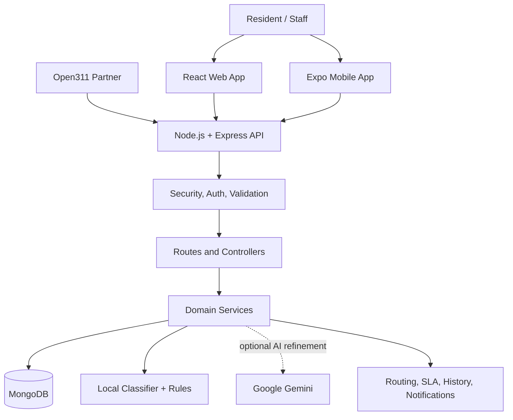

# NagriVanta

<p align="center">
  
</p>

<h3 align="center">From pothole to proof of fix.</h3>

<p align="center">
  A civic issue reporting and resolution platform connecting residents with municipal teams.
</p>

<p align="center">
  <a href="https://github.com/naitik2043/NagriVanta/actions/workflows/ci.yml">
    
  </a>
  <a href="https://github.com/naitik2043/NagriVanta/blob/main/LICENSE">
    
  </a>
  
  
  
</p>

<p align="center">
  <a href="https://nagrivanta-web-topaz.vercel.app/"><strong>Live Web App</strong></a> ·
  <a href="https://nagrivanta-api-iota.vercel.app/api/docs"><strong>API Docs</strong></a> ·
  <a href="docs/DEMO_GUIDE.md"><strong>Demo Guide</strong></a> ·
  <a href="docs/ARCHITECTURE.md"><strong>Architecture</strong></a>
</p>

---

## Overview

NagriVanta is an AI-assisted civic-tech platform for reporting, routing, tracking, and resolving everyday public-service issues. Residents can report potholes, garbage, water leaks, damaged streetlights, and blocked drains. Municipal teams can review incoming complaints, assign work to departments and officers, update case progress, and record resolution evidence.

The current pilot is configured for **Ghaziabad and Noida, Uttar Pradesh**.

> **AI recommends. Rules validate. People decide.**
>
> Classification, priority scoring, duplicate matching, and evidence checks support the workflow. Authorised staff remain responsible for decisions.

## Product preview

The screenshot below is from the NagriVanta web application.

<p align="center">
  
</p>

<p align="center">
  <a href="https://nagrivanta-web-topaz.vercel.app/">Open the live application</a>
</p>

## Live demo and developer links

| Resource | Link |
| --- | --- |
| Web application | [NagriVanta Web](https://nagrivanta-web-topaz.vercel.app/) |
| Backend API | [NagriVanta API](https://nagrivanta-api-iota.vercel.app/) |
| Interactive Swagger docs | [API Documentation](https://nagrivanta-api-iota.vercel.app/api/docs) |
| OpenAPI JSON | [API specification](https://nagrivanta-api-iota.vercel.app/api/openapi.json) |
| Health endpoint | [API health](https://nagrivanta-api-iota.vercel.app/health) |
| Open311 service catalogue | [Open311 services](https://nagrivanta-api-iota.vercel.app/open311/v2/services.json) |

These are the deployment URLs recorded for the project. Check the health endpoint and sign-in flow before a live presentation; a published URL does not guarantee current service or demo-account availability.

**Hosted demo login:** [Open the sign-in page](https://nagrivanta-web-topaz.vercel.app/login). The production environment has separately provisioned staff accounts. Their temporary passwords are not published here because they are private, may have been rotated, and must be distributed only to authorised demo participants. If a hosted login fails, request an admin-approved password reset. The local demo password below does not work on production.

### Local demo IDs and password

Run the backend using `npm run demo` first. The local in-memory seed creates the following sample accounts. **The password for every account in this table is `Demo@12345`.**

| Role | Local demo login email | Password |
| --- | --- | --- |
| Administrator | `admin@nagrivanta.local` | `Demo@12345` |
| Ghaziabad — PWD Officer | `pwd.officer@nagrivanta.local` | `Demo@12345` |
| Ghaziabad — Sanitation Officer | `san.officer@nagrivanta.local` | `Demo@12345` |
| Ghaziabad — Water Officer | `jal.officer@nagrivanta.local` | `Demo@12345` |
| Ghaziabad — Electrical Officer | `ele.officer@nagrivanta.local` | `Demo@12345` |
| Ghaziabad — Drainage Officer | `drn.officer@nagrivanta.local` | `Demo@12345` |
| Noida — PWD Officer | `noida.pwd.officer@nagrivanta.local` | `Demo@12345` |
| Noida — Sanitation Officer | `noida.san.officer@nagrivanta.local` | `Demo@12345` |
| Noida — Water Officer | `noida.jal.officer@nagrivanta.local` | `Demo@12345` |
| Noida — Electrical Officer | `noida.ele.officer@nagrivanta.local` | `Demo@12345` |
| Noida — Drainage Officer | `noida.drn.officer@nagrivanta.local` | `Demo@12345` |
| Citizen | `citizen1@nagrivanta.local` | `Demo@12345` |

These are disposable **local-only** accounts backed by the in-memory demo database. They are recreated when the demo server starts and are not production credentials.

NagriVanta is an independent civic-tech pilot, **not an official government portal or an emergency-response service**.

## Key capabilities

| Capability | What it provides |
| --- | --- |
| Resident reporting | Submit civic complaints with descriptions, location, photos, and short videos |
| Multiple reporting channels | Web, mobile, voice-enabled input, AI assistant/chat, and Open311 integration |
| AI-assisted triage | Local text classification, optional Gemini refinement, summaries, category and priority suggestions |
| Explainable prioritisation | Rule-based priority factors such as safety risk, blocked access, health hazards, and community signals |
| Smart department routing | Suggests the relevant city department and can assign to the least-loaded eligible officer |
| Duplicate suggestions | Compares text, distance, category, and image similarity to highlight potentially related reports |
| Role-based workflows | Separate permissions and work queues for citizens, officers, and administrators |
| Case tracking | Reference IDs, status timeline, updates, notifications, and citizen feedback |
| Resolution evidence | Supports after-photos and checks available image, timestamp, and location signals |
| Auditability | Complaint history uses a SHA-256 hash chain with an integrity-check endpoint |
| SLA monitoring | Department deadlines, overdue-case escalation, and scheduled retry/escalation job |
| Maps and analytics | Map-based reporting, public scorecards, ward insights, and workload views |
| Public data and integration | Privacy-limited tracking, aggregate open-data exports, and Open311 GeoReport v2 endpoints |
| Accessible experience | English/Hindi interface, PWA support, and offline report queueing in supported clients |

AI classification and evidence checks are assistance signals, not a substitute for human review or proof of municipal completion.

## How it works

### System architecture



### Typical complaint lifecycle

```text
Resident submits a complaint
           |
           v
Validation, media checks and location handling
           |
           v
Complaint saved with a reference ID
           |
           v
Local triage + explainable priority score
           |
           v
Department suggestion / eligible officer assignment
           |
           v
Admin review and officer processing
           |
           v
In progress -> Resolved -> Closed
           |
           v
Evidence, audit history and resident feedback
```

The exact state transitions depend on the current status and the user's role. For the detailed state machine and service responsibilities, see [System Architecture](docs/ARCHITECTURE.md).

## Technology stack

| Layer | Technologies |
| --- | --- |
| Web frontend | React 19, Vite, Tailwind CSS |
| Backend | Node.js 20+, Express 5 |
| Database | MongoDB, Mongoose |
| Mobile | Expo, React Native |
| Authentication | JWT, bcryptjs |
| Validation and API security | Zod, Helmet, CORS, express-rate-limit |
| AI and classification | Local Naive Bayes classifier, deterministic rules, optional Google Gemini |
| Maps and visualisation | Leaflet, React Leaflet, Recharts |
| API documentation | OpenAPI 3.1, Swagger UI |
| Testing | Node.js test runner, Supertest, mongodb-memory-server |
| Deployment | Vercel |
| CI | GitHub Actions |

## Repository structure

```text
NagriVanta/
├── client/                     # React + Vite web application
│   ├── public/                 # App icon, PWA manifest and service worker
│   └── src/
│       ├── components/         # Shared UI, maps, charts and assistant
│       ├── context/            # Auth, preferences and theme contexts
│       ├── hooks/              # Reusable hooks
│       ├── pages/              # Web application pages
│       └── services/           # API client and frontend services
│
├── mobile/                     # Expo / React Native app
│   └── src/
│       ├── app/                # Mobile screens and navigation
│       ├── components/         # Reusable mobile UI
│       └── lib/                # API, auth, preferences and offline outbox
│
├── server/                     # Express backend
│   ├── api/                    # Vercel serverless entry
│   ├── scripts/                # Demo, seed, evaluation and training scripts
│   ├── src/
│   │   ├── config/             # Environment, database, security and OpenAPI
│   │   ├── controllers/        # HTTP handlers
│   │   ├── middleware/         # Auth, errors and media uploads
│   │   ├── models/             # Mongoose models
│   │   ├── routes/             # API route definitions
│   │   ├── services/           # Business logic, AI, routing and workflow
│   │   └── validators/         # Zod request schemas
│   └── tests/                  # API, unit and security tests
│
├── data/                       # Synthetic and evaluation datasets
├── docs/
│   ├── assets/                 # README product screenshots
│   ├── ARCHITECTURE.md         # Backend and system design
│   ├── API_DOCUMENTATION.md    # Route and API reference
│   ├── LOCAL_SETUP.md          # Detailed local setup and troubleshooting
│   ├── DEMO_GUIDE.md           # End-to-end presentation guide
│   ├── DEPLOYMENT.md           # Vercel deployment instructions
│   └── NagriVanta-User-Guide.pdf
└── .github/workflows/          # CI workflow
```

## Run locally

### Prerequisites

- Node.js **20 or newer** (CI currently uses Node.js 22).
- npm and Git.
- Internet access for package installation and the first in-memory MongoDB binary download.
- MongoDB Community Server or Atlas only for persistent local development.

### Recommended: zero-setup local demo

The backend provides a dedicated demo command. It starts a temporary in-memory MongoDB instance, creates sample departments, users and complaints, then starts the Express API. No MongoDB installation, Atlas account, or Gemini key is needed for this mode.

**Terminal 1 — Backend**

```bash
git clone https://github.com/naitik2043/NagriVanta.git
cd NagriVanta/server
npm install
npm run demo
```

Keep this terminal running. On the first launch, `mongodb-memory-server` may download a MongoDB binary.

**Terminal 2 — Web client**

```bash
cd NagriVanta/client
npm install
npm run dev
```

Open [http://localhost:5173](http://localhost:5173/).

**Local demo login**

```text
Admin:    admin@nagrivanta.local
Citizen:  citizen1@nagrivanta.local
Password: Demo@12345
```

Additional department officer accounts are listed in the [Local Setup guide](docs/LOCAL_SETUP.md#local-demo-accounts).

> **Demo data is temporary.** Stopping the backend removes the in-memory database. Restarting `npm run demo` creates a fresh dataset. Do not run the persistent seed script against production or a shared database.

### Persistent local development

For data that should survive server restarts, configure MongoDB and the backend environment file:

```bash
cd server
npm install
```

Copy `server/.env.example` to `server/.env`, then configure at least:

```env
PORT=5000
NODE_ENV=development
MONGODB_URI=mongodb://127.0.0.1:27017/nagrivanta
JWT_SECRET=replace-with-a-long-random-string
CORS_ORIGINS=http://localhost:5173,http://localhost:8081
```

Then start the backend:

```bash
npm run dev
```

See [Local Development Setup](docs/LOCAL_SETUP.md) for Windows/macOS/Linux commands, mobile networking, optional Gemini configuration, and troubleshooting.

## Backend API overview

The application API is mounted under `/api/v1`.

| Area | Example endpoints |
| --- | --- |
| Authentication | `POST /auth/register`, `POST /auth/login`, `GET /auth/me` |
| Public information | `GET /public/scorecard`, `GET /public/risk-alerts`, `GET /public/track/:ref` |
| Profile | `GET /profile`, `PATCH /profile`, `POST /profile/password` |
| Complaints | `POST /complaints`, `GET /complaints/mine`, `GET /complaints/:id` |
| Workflow | `PATCH /complaints/:id/status`, `PATCH /complaints/:id/assign`, `POST /complaints/:id/notes` |
| Assistant | `POST /assistant/chat` |
| Administration | `GET /admin/analytics`, `GET /admin/workload`, `POST /admin/users` |
| Notifications | `GET /notifications`, `PATCH /notifications/:id/read` |

Open311 GeoReport v2-compatible endpoints are mounted at `/open311/v2`.

For methods, access requirements, payload examples, and the complete route catalogue, see [API Documentation](docs/API_DOCUMENTATION.md) or open the [interactive Swagger UI](https://nagrivanta-api-iota.vercel.app/api/docs).

## Documentation

| Guide | Description |
| --- | --- |
| [System Architecture](docs/ARCHITECTURE.md) | Application boundaries, authentication, AI triage, routing, status workflow, audit and data models |
| [API Documentation](docs/API_DOCUMENTATION.md) | Endpoints, roles, request examples, responses and errors |
| [Local Setup](docs/LOCAL_SETUP.md) | Full setup for quick demo, persistent backend, web, mobile and troubleshooting |
| [Demo Walkthrough](docs/DEMO_GUIDE.md) | Step-by-step resident, admin and officer presentation flow |
| [Deployment Guide](docs/DEPLOYMENT.md) | Vercel project configuration, environment variables and production verification |
| [User Guide](docs/NagriVanta-User-Guide.pdf) | User-facing application guidance |

## Development and quality checks

Backend tests:

```bash
cd server
npm ci
npm test
```

Frontend lint and production build:

```bash
cd client
npm ci
npm run lint
npm run build
```

Mobile web export:

```bash
cd mobile
npm ci
npx expo export --platform web
```

The GitHub Actions workflow runs frontend lint/build, backend tests, and mobile web export on pushes and pull requests targeting `main`. Check the live [CI workflow](https://github.com/naitik2043/NagriVanta/actions/workflows/ci.yml) for its current status.

## Security and responsible use

- Keep real credentials in ignored local environment files or the hosting provider's secret store.
- Never commit API keys, JWT/cron secrets, MongoDB connection strings/passwords, hosted staff passwords, private preview URLs, or deployment identifiers.
- Rotate any credential exposed in chat, logs, screenshots, commits, or other public locations.
- **Never run `npm run seed` against production or a shared database.** It deletes the NagriVanta collections in the configured database before inserting sample data.
- Use synthetic or explicitly authorised data for demos and tests.
- Public tracking and aggregate data views are designed to avoid exposing reporter contact details. Do not submit unnecessary personal information.
- AI suggestions and evidence checks can be wrong and must be reviewed by authorised staff.
- Do not use NagriVanta to report emergency incidents. Contact the appropriate local emergency service.

## Contributing

Contributions are welcome. Please open an issue or pull request with context about the proposed change, keep changes focused, add or update tests where appropriate, and run the relevant checks before submitting.

Do not include private resident information, production credentials, database dumps, or confidential operational logs in issues, commits, screenshots, or pull requests.

---

<p align="center">
  Built to make civic reporting more transparent, accountable, and accessible.
</p>
