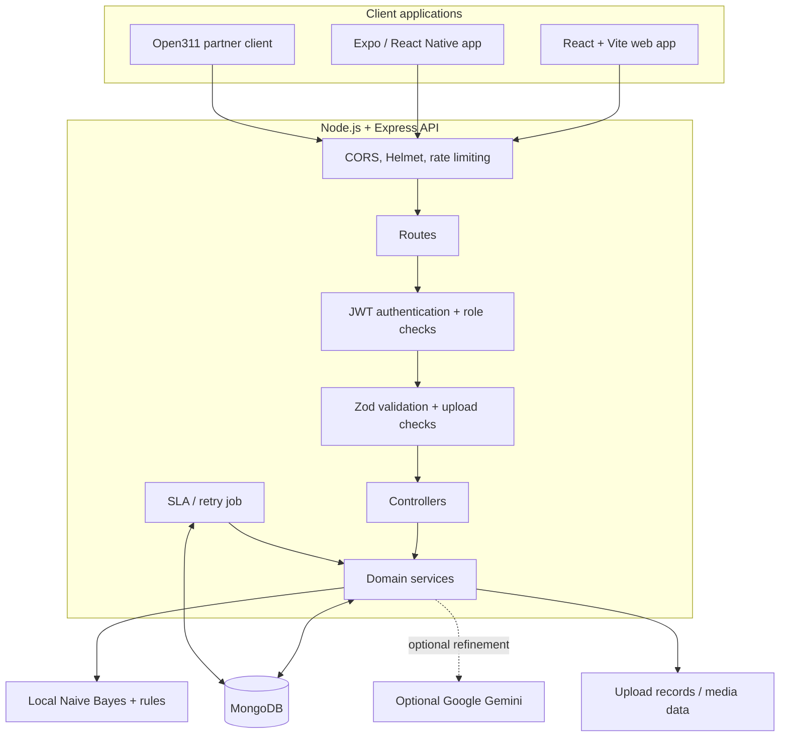
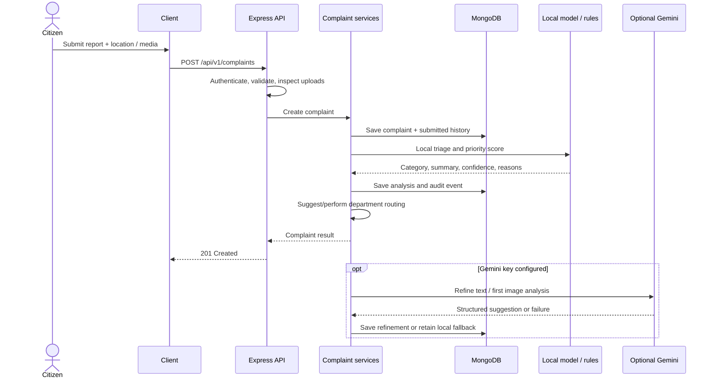

# NagriVanta — System Architecture

This document describes the current repository implementation. It is intended for developers, reviewers, and contributors who need to understand the application boundaries and the backend request lifecycle.

## 1. High-level architecture

NagriVanta has three application clients: a React web application, an Expo / React Native mobile application, and external Open311-compatible clients. They communicate with a shared Node.js / Express API. The API uses MongoDB through Mongoose.



**Important:** The local classifier and deterministic rules are part of the backend. Gemini is optional. Core complaint submission does not depend on Gemini being available.

## 2. Repository responsibilities

| Directory | Responsibility |
| --- | --- |
| `client/` | React web app, routes/pages, shared UI, authentication context, API client, maps and charts |
| `mobile/` | Expo / React Native app, screens, API client, authentication and offline submission queue |
| `server/src/app.js` | Express application setup, security middleware, health endpoints, docs and API mounting |
| `server/src/server.js` | Local server startup, MongoDB connection and periodic SLA/retry job |
| `server/api/index.js` | Vercel serverless entry point and shared MongoDB connection handling |
| `server/src/routes/` | HTTP route declarations and access-control middleware |
| `server/src/controllers/` | Request parsing, orchestration and HTTP responses |
| `server/src/services/` | Complaint workflow, triage, prioritisation, duplicates, routing, analytics and verification |
| `server/src/models/` | Mongoose schemas and persistence |
| `server/src/middleware/` | JWT authentication, errors and media upload handling |
| `server/src/validators/` | Zod request schemas |
| `server/scripts/` | Local demo, destructive seed, evaluation and classifier training scripts |
| `data/` | Bundled synthetic/evaluation data |
| `docs/` | Project and developer documentation |

## 3. Request lifecycle

A typical browser or mobile request follows this path:

1. The client calls the API through its shared API helper.
2. Express applies request ID, Helmet, CORS, JSON/form parsing and rate limiting.
3. The router selects the endpoint and attaches authentication/role checks where required.
4. Zod validates structured request fields; upload middleware checks and processes media when applicable.
5. The controller calls domain services and reads/writes MongoDB through Mongoose.
6. The API returns a consistent JSON response or a structured error.

The web development server proxies `/api`, `/uploads`, and `/health` to the local Express server on port `5000`. In production, the web client uses `VITE_API_URL` to call the deployed API.

## 4. Authentication and authorisation

- Registration creates a **citizen** account. Staff roles are provisioned through the admin workflow.
- Passwords are stored as bcrypt hashes; plaintext passwords are not stored.
- On login, the API issues a signed JWT containing the user ID (`sub`) and role.
- Clients send the token in the `Authorization: Bearer <token>` header.
- `requireAuth` verifies the signature, loads the current user from MongoDB, and rejects missing, invalid, inactive, or expired sessions.
- `requireRole(...roles)` enforces role boundaries at the route.
- Officer complaint access is further restricted to the assigned officer or their department.
- The web client stores its session token in browser local storage. The mobile client uses its app authentication/storage helpers.

Logout is stateless on the API: the client discards its token. A future request with a discarded token is no longer sent by that client.

## 5. Complaint creation and AI-assisted triage



The implementation uses a fast local pass first:

- If the report category is automatic, keyword rules provide an initial category.
- The bundled Naive Bayes model classifies text using words, bigrams and character n-grams. Character n-grams help with spelling variation and Hindi/Hinglish text.
- Explainable rules calculate priority from factors such as safety risk, blocked access, nearby sensitive places, duration, health hazards, community votes and duplicate reports.
- If `GEMINI_API_KEY` is configured, Gemini may refine the local result using the report text and the first attached image. Gemini output is validated with Zod.
- If Gemini is not configured, times out, or returns an unusable response, the local result remains available. Triage is advisory; staff can review and correct it.

### Routing

The routing service selects an active department matching the report's city and category. When auto-assignment is enabled, it chooses the least-loaded active officer in that department.

Automatic assignment requires a reliable category: a citizen-selected category, or an AI-selected category whose stored confidence meets the configured threshold. Otherwise, the system records a suggested department for staff review. Admins can manually assign or reassign cases.

## 6. Duplicate suggestions

The duplicate service searches reports within a configured geographic radius and time window. Candidate scoring combines:

- Text similarity.
- Geographic proximity.
- Category match.
- Perceptual image similarity when both reports have images.

The service returns **suggestions**. It does not automatically merge or delete complaints; a human reviewer decides what to do.

## 7. Status workflow

The state machine is defined in `server/src/config/constants.js` and guarded by `server/src/services/workflow.js`.

Common progression:

```text
submitted
   |
   v
under_review
   |
   +--> needs_info --> under_review
   |
   v
assigned
   |
   v
in_progress
   |
   +--> blocked --> in_progress
   |
   v
resolved --> closed
   |
   +--> reopened --> under_review / in_progress
```

Additional transitions include rejection and administrative return-to-review paths. The server checks the current state, target state, user role, officer assignment and required fields before applying a transition.

Resolution requires a resolution note and at least one new after-photo. Evidence checks can compare image hashes, prior uploads, EXIF capture time and GPS proximity. Optional visual comparison may add another signal. These checks are review signals, not an automatic guarantee that work was completed.

## 8. Audit trail, notifications and SLA

- Status and key workflow events are stored in `ComplaintHistory`.
- Each history entry contains the previous entry's hash and a SHA-256 digest of canonical event fields. The integrity endpoint recomputes the chain to detect modifications.
- Notifications are persisted for relevant users after workflow actions.
- Department/priority SLA deadlines are recorded on assigned cases.
- The SLA job marks overdue active complaints as escalated once, records the event, and notifies the assignee and admins.
- The Vercel configuration schedules the protected job endpoint. The local server also starts a periodic job.

## 9. Main data models

| Model | Purpose |
| --- | --- |
| `User` | Citizen, officer and admin account records |
| `Complaint` | Report content, category, priority, location, status, AI analysis, routing and resolution |
| `Department` | City department, supported categories and SLA configuration |
| `ComplaintHistory` | Workflow events and tamper-evident hash chain |
| `Notification` | In-app alerts |
| `Upload` | Stored media and related metadata/hashes |
| `Feedback` | Citizen feedback after resolution |
| `Vote` | Community upvotes |
| `Cache` | Cached service data |

## 10. Further reading

- [API reference](API_DOCUMENTATION.md)
- [Local development setup](LOCAL_SETUP.md)
- [Demo walkthrough](DEMO_GUIDE.md)
- [Deployment guide](DEPLOYMENT.md)
- [OpenAPI definition](../server/src/config/openapi.yaml)
